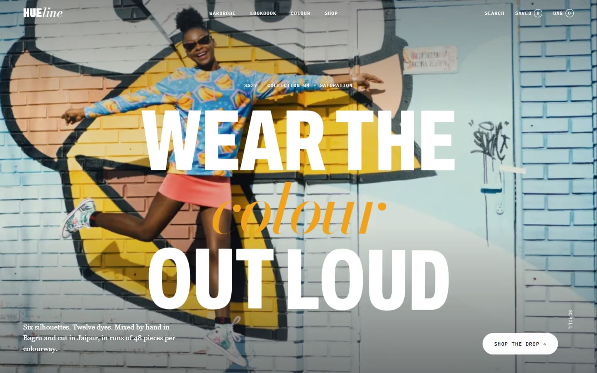

# HUELINE · Saturation SS27

[](https://codelady-ship.github.io/Ecommerse-app/)
[](https://github.com/codelady-ship/Ecommerse-app/actions/workflows/deploy.yml)
[](https://github.com/codelady-ship/Ecommerse-app/actions/workflows/api-tests.yml)

A fashion lookbook and shop for **HUELINE**, a fictional womenswear label, built as a full-stack portfolio project:
a motion-heavy React front end (GSAP ScrollTrigger + Flip, Lenis) and a Node/Express + MongoDB API for the catalogue,
bag, saved list, demo checkout and newsletter. **It is a demo: nothing is for sale and no payments are taken.**

> AZ: Uydurma moda brendi üçün React + GSAP ilə hazırlanmış lookbook və mağaza, Express + MongoDB API ilə (səbət, seçilmişlər, demo sifariş, çatdırılma hesablaması). Portfolio layihəsidir, real ödəniş yoxdur.



## What is on the page

| Section | What it does |
| --- | --- |
| Loader | Five dye bands rise while a counter runs 000 → 100, then lift away from the centre and hand over to the hero |
| Hero | Pinned; the film opens up on load, then narrows into an arch while two close-ups rise beside it |
| Ticker | Endless line of styles and dyes |
| Six styles | Arched gallery that wipes in and drifts at six speeds; a click filters the shop |
| Wardrobe ring | 3D concave cylinder of 14 cards: drifts, follows scroll velocity, drags (pointer or ← →), caption follows the front card |
| Style rails | One endless rail per style: drift, pause on hover, drag, fling with momentum |
| Lookbook | Pinned horizontal scroll through six looks (vertical stack on phones) |
| Colour story | The whole section repaints dye by dye as each swatch crosses the middle of the screen |
| Shop | Style tabs, sort, "show all", every change animated with GSAP Flip |
| Film band, Atelier | Widening frame; counters that count up |
| Product page | `/product?code=HL-T-01`: gallery with click-to-zoom, colourways, sizes + size chart, add to bag, save, pincode delivery check |
| Overlays | Bag/Saved drawer, search, quick view, mobile menu; focus trap, Escape, scroll lock, focus return |
| Checkout | `/checkout`: validated form, server-side prices, demo order confirmation |

Also: custom cursor (hidden on touch), magnetic buttons, `prefers-reduced-motion` support (no loader, no pinning, Flip at 0 s),
responsive from 360 px to 1920 px without horizontal scroll, 44 px touch targets and 12 px minimum text, per-route
title/description/canonical/OG tags, JSON-LD (Organization + WebSite, an ItemList of the shop on the home page, Product +
BreadcrumbList on product pages; no offers or ratings because nothing is for sale), `robots.txt`, `sitemap.xml`, `llms.txt`,
width/height on every photo and a preloaded hero poster.

## Architecture

```
src/                      React 19 + Vite app (GitHub Pages)
  data/catalog.js         ASSETS / VIDEOS lists, src() helper, views, dyes, sizes (window.HL)
  lib/api.js              API client: 8 s timeout, falls back to demo mode when the API is missing or down
  lib/store.js            Zustand: catalogue, bag + saved (localStorage, synced to the API), overlays
  lib/motion.js           GSAP, ScrollTrigger, Flip, Lenis setup and reveal helpers
  sections/ pages/ components/
backend/                  Express 5 + Mongoose API (Render)
  src/data/catalog.json   the 24 products, 6 styles, 9 colours: single source for the seed AND the front end
  src/lib/delivery.js     delivery rules, shared with the front end
  test/api.test.js        25 supertest tests on an in-memory MongoDB
render.yaml               Render Blueprint for the API
```

The front end works on its own: without `VITE_API_BASE_URL` (or when the API does not answer within 8 s) it uses the
bundled catalogue, local delivery rules and `localStorage`, so the GitHub Pages site always works.

## Run locally

```bash
# front end
npm install
npm run dev            # http://localhost:5173/Ecommerse-app/
npm run build          # dist/ (also writes dist/404.html for deep links)

# API (optional, needs MongoDB; see backend/README.md)
cd backend
npm install
cp .env.example .env   # set MONGODB_URI and JWT_SECRET
npm run seed
npm run dev            # http://localhost:4000/api/health
npm test               # supertest suite, downloads an in-memory MongoDB the first time

# point the front end at it
echo VITE_API_BASE_URL=http://localhost:4000 > .env.local
```

## Deployment

- **Front end:** every push to `main` runs `.github/workflows/deploy.yml`, which builds and publishes `dist/` to the
  `gh-pages` branch. To use the live API, add a repository variable `VITE_API_BASE_URL`
  (Settings → Secrets and variables → Actions → Variables) and re-run the workflow.
- **API:** Render → New → Blueprint → this repo (uses `render.yaml`). Fill in `MONGODB_URI` (for example a free
  MongoDB Atlas M0 cluster), `ADMIN_EMAIL`, `ADMIN_PASSWORD` and optionally `CLOUDINARY_URL`. The database is seeded on
  first boot. Free Render services sleep when idle; the front end falls back to demo data while the API wakes up.

## Admin panel

[`/admin`](https://codelady-ship.github.io/Ecommerse-app/admin/) is a small back office for the API's admin routes:
products (search, create, edit, hide, delete), demo orders and newsletter subscribers. It stands alone without the
shop nav, so it also works inside an iframe, and keeps its JWT in `sessionStorage` (no cookies).

- **Demo admin** button, or `demo@hueline.az` / `demo1234` (public on purpose). The seed creates this account with role
  `demo`; the API lets it read everything and answers every write with a 403 *Demo admin is read-only*, shown as a
  toast. `DEMO_ADMIN=off` + re-seed removes it. Real admins (`ADMIN_EMAIL`) keep full rights.
- **No API?** When `VITE_API_BASE_URL` is empty or the API cannot be reached, the demo login opens an in-browser sandbox
  built from the bundled catalogue. Edits work but stay in this tab (`sessionStorage`), under a visible
  *Demo mode — changes are not saved* note with a reset button.

## Tech stack

React 19 · React Router 7 · Zustand 5 · GSAP 3.12.5 (ScrollTrigger, Flip) · Lenis 1.1.13 · Vite 6 ·
Node 22 · Express 5 · Mongoose 8 · zod · JWT · multer · helmet · express-rate-limit · node:test + supertest ·
GitHub Actions · GitHub Pages · Render

## Credits

Photos are CC0 images from StockSnap, listed with their photographers in [docs/CREDITS.md](docs/CREDITS.md).
The four film slots play free Pexels clips (Pexels License, also credited in docs/CREDITS.md); with reduced motion
they show their poster photos. HUELINE, its products and its people are fictional.
