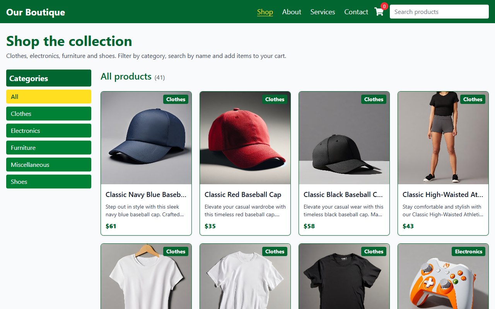

# Our Boutique: React e-commerce demo

[](https://codelady-ship.github.io/Ecommerse-app/)
[](https://github.com/codelady-ship/Ecommerse-app/actions/workflows/deploy.yml)

A small online store built with React. You can browse 41 sample products, filter them by category, search by name,
open a product page with a photo gallery and keep a shopping cart that survives page reloads. It is a front-end
portfolio project: the checkout and the contact form are demos and send nothing.

> AZ: React ilə hazırlanmış demo onlayn mağaza: kateqoriya filtri, axtarış, məhsul səhifələri və brauzerdə saxlanan səbət.



## Features

- Product catalogue loaded from a static JSON file (`public/data.json`)
- Category filter, live search and pagination (8 products per page)
- Product detail pages at `/products/:slug` with an image gallery and star rating
- Cart with add, quantity +/-, remove, clear and a demo checkout, persisted to `localStorage` with Zustand
- Contact form with client-side validation and a demo confirmation toast
- Responsive layout with a mobile menu, from 390 px phones to 1920 px screens
- SEO basics: title, meta description, canonical, Open Graph/Twitter tags, `robots.txt`, `sitemap.xml`

## Tech stack

React 19 · React Router 7 · Zustand 5 · Tailwind CSS 4 · Vite 6 · react-hot-toast · react-icons · GitHub Actions + GitHub Pages

## Run locally

```bash
git clone https://github.com/codelady-ship/Ecommerse-app.git
cd Ecommerse-app
npm install
npm run dev      # http://localhost:5173/Ecommerse-app/
npm run build    # production build in dist/ (also writes dist/404.html for SPA routes)
npm run preview  # serve the production build
```

No environment variables are needed (see `.env.example`).

## Deployment

`vite.config.js` sets `base: '/Ecommerse-app/'` and the router uses `basename={import.meta.env.BASE_URL}`, so a fresh
build from `main` matches the live site. The workflow in `.github/workflows/deploy.yml` runs on every push to `main`:
it builds the app and publishes `dist/` to the `gh-pages` branch, which GitHub Pages serves.
`dist/404.html` is a copy of `index.html`, so deep links such as `/products/<slug>` load the app.

## What I learned

- Static files that the app fetches belong in `public/` and must be requested with `import.meta.env.BASE_URL`;
  relative paths like `../../data.json` break as soon as the app is served from a sub-path.
- Commit the deploy config (`base`, `basename`, workflow) so the live site can be rebuilt from the repo.
- Zustand's `persist` middleware is a simpler and safer way to sync state with `localStorage` than writing to it by hand.
- Never commit `.env`; commit `.env.example` instead.
